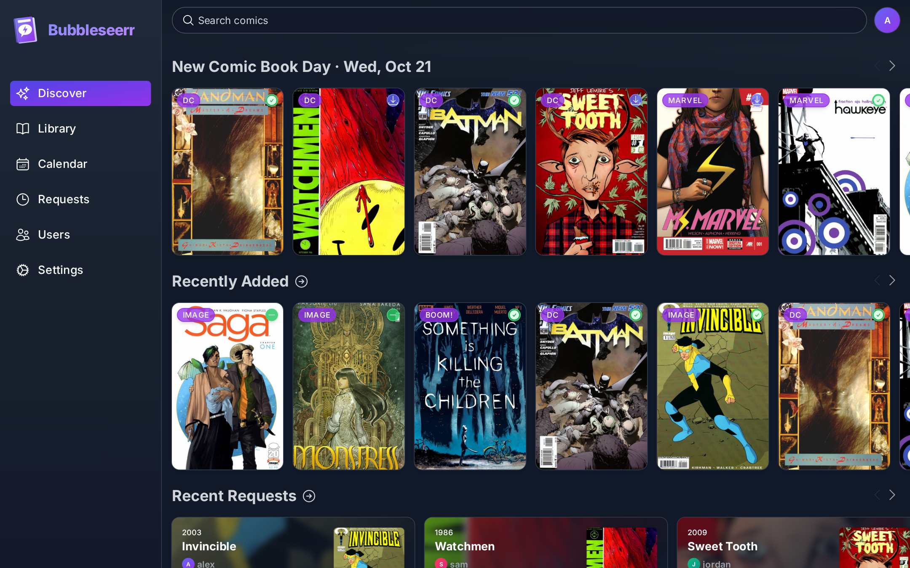
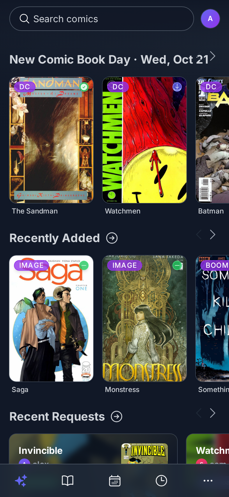

<div align="center">


# Bubbleseerr

**A comic request app for [Bubblarr](https://github.com/RaihanKaskandar/bubblarr), in the style of Seerr.**

</div>

People log in, browse and search comics, see what's already in the library, and request what's missing. Requests go
straight to Bubblarr, which finds and downloads them. It is to Bubblarr what [Seerr](https://github.com/seerr-team/seerr)
is to Sonarr and Radarr.

> [!WARNING]
> **This project is entirely vibe coded.**
> I built Bubbleseerr for myself, so the people I share my comic library with can request comics, and it was written
> with an AI assistant rather than carefully coded by hand. I decided to put it online in case it is useful to someone
> else too.
>
> That means: no promise it won't break or that it will stay secure. Feel free to use it, but do so at your own risk.
> Back up your data, and expect rough edges. Issues and pull requests are welcome, but I can't promise a fast reply.

## Screenshots



<p align="center"></p>

<sub>With a demo library. Covers from ComicVine.</sub>

## Features

- **Discover:** recently added comics, recent requests, new releases and upcoming issues.
- **Search:** ComicVine search, through Bubblarr, with the library status of every comic. Foreign editions are hidden
  by default.
- **Comic pages:** description, every issue with its status, and a "Read in Kavita" button when available.
- **Beginner-friendly requests:** the whole series, only new issues, or hand-picked issues.
- **Requests list:** with status, retry and remove.
- **Users:** the admin creates accounts and sets permissions (Admin, Manage Settings, Manage Users, Manage Requests,
  Request, View Requests). People can also sign in with their Kavita or Komga account.
- **Publishers:** everyone picks the publishers they want to see, for example only DC, Marvel and Image.
- **Works everywhere:** phone (bottom tab bar, home screen app), tablet and desktop.
- **Live updates:** Bubblarr's webhooks mark requests as available right away, with a sync every 10 minutes as a
  fallback.

## Getting started

You need a running [Bubblarr](https://github.com/RaihanKaskandar/bubblarr). Kavita or Komga is optional.

```bash
git clone https://github.com/RaihanKaskandar/bubbleseerr.git
cd bubbleseerr
docker compose up -d --build
```

Then open <http://localhost:5056> and follow the setup:

1. Create the admin account.
2. Connect Bubblarr (its URL, plus the API key from Bubblarr → Settings → General).
3. Optionally connect Kavita.
4. Copy the webhook URL and secret into Bubblarr → Settings → General → Webhooks.

Set `TZ` in `compose.yaml` to your own time zone. To update, pull the latest code and run `docker compose up -d --build`
again.

Everything is stored in one SQLite database in the `bubbleseerr-config` Docker volume, so it survives updates and
restarts. To back it up, copy the folder out of the container:

```bash
docker compose cp bubbleseerr:/app/config ./bubbleseerr-backup
```

If you'd rather use a folder on your server, map it to `/app/config` and make it writable for user 1000 (the user the
app runs as).

## Development

You need [Node.js](https://nodejs.org) 22 or newer.

```bash
npm install
npm run dev        # http://localhost:5056
npm test           # unit tests (Vitest)
npm run typecheck
```

## Author

Created by **Raihan Kaskandar** ([@RaihanKaskandar](https://github.com/RaihanKaskandar)), who engineered the requirements,
designed the full-stack architecture and the user interface, and directed the AI. The code itself was written by Claude,
an AI coding assistant.

## Credits and license

The look and many components are adapted from [Seerr](https://github.com/seerr-team/seerr). Thanks to the Seerr team for
a great app to build on ❤️. Like Seerr, Bubbleseerr is licensed under the [MIT license](LICENSE).

Publisher logos belong to their publishers and are only used to show which publisher a comic is from.
